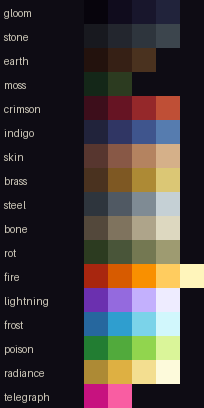

# Стиль-библия Glimmerfall — черновик (G2.1)

**Статус:** черновик 2026-10-26 по [ADR 0003](../adr/0003-art-direction.md); палитру и правила предложил ИИ-агент, утверждает владелец, дорабатывает концепт-художник (G2.2). Источник правды — данные и код, документ их объясняет:
- палитра — [`content/art/palette.json`](../../content/art/palette.json) (схема — `content/schema/palette.schema.json`), для Aseprite — [`palette.gpl`](../../content/art/palette.gpl), превью ниже — `make palette`;
- правила палитры проверяет `tools/sprites/tests/test_palette.py`, кадры — QA конвейера (скилл `sprite-pipeline`), кадр игры без цвета — `glimmer_sprites readability`.

## 1. Палитра
- **60 цветов из 64**, 17 рамп тёмный → светлый: 4 мира, 7 материалов, 5 эффектов, 1 телеграфов. Рампы делят тёмные концы (индиго начинается с `gloom3`, латунь — с `earth3`, сталь — с `stone3`, плоть — с `moss2`, сияние — с `brass2`): так тени разных материалов родственны, а слоты не тратятся.
- Цвета подобраны в OKLCH со сдвигом тона: тени холоднее и к фиолетовому, свет теплее, хрома выше всего в середине рампы.
- **Правила (тест):** соседние тона рампы светлее хотя бы на 0,04 L; любые два цвета различимы (ΔE_OK ≥ 0,025); у каждой рампы эффектов есть ядро L ≥ 0,90; контур (`ink`) — самый тёмный цвет; телеграф зарезервирован — его нет ни в одной другой рампе, и он отстоит от любого насыщенного цвета эффектов игрока на ΔE_OK ≥ 0,12 и на 35° по тону.
- **Квантование структурное:** кадр собирается из пары (рампа материала, полоса света) → индекс палитры. Адаптивной палитры на лист нет; листы — индексированные PNG, «все пиксели из палитры» верно по построению и проверяется тестом.

## 2. План светлоты (OKLab L)
| Слой | L | Что значит |
|---|---|---|
| world | 0.10–0.40 | мир в нижней трети светлоты: пол `stone2` (0,27), швы `stone1`, Тьма — рампа `gloom` |
| material | 0.20–0.90 | персонажи и предметы: тени не темнее мира, блики до кости и латуни |
| vfx | 0.45–1.00 | эффекты всегда светлее мира, ядро ≥ 0,90 |
| telegraph | 0.50–0.75 | угрозы: средняя светлота при максимальной хроме — видны и на тёмном полу, и на светлом эффекте |

Диапазоны — `lightness` в палитре; тест сверяет их с этой таблицей.

- **Пятно света фонаря лежит на полу, под фигурами.** Поверх фигур аддитивный свет высветлял тёмный контур героя, и контраст границы падал до 0,08–0,14 L; под фигурами — 0,14–0,29 ([G2.6](../spikes/G2.6-grid-readability.md)).
- **Ключ светлоты героя — со всех восьми направлений.** Без цвета героя отделяет от орды доля светлых пикселей силуэта (L выше пола на 0,15). Лицом к камере светлая туника даёт 45–47% против 8–9% у гулей; со спины плащ прячет её, и разница падает до 7–8% — герой читается только фонарём. Капюшон, плечи или кромка плаща героя должны быть светлее орды и сзади: это задание концепт-художнику.
- **Орда — средне-тёмная, с тёмным контуром.** Рядовые читаются контуром `ink` на полу (контраст границы 0,27) и средней плотью; светлое оставлено герою, пикапам и эффектам.

## 3. Свет и форма
- Ключевой свет сверху слева, 3 полосы тона: тень / свет / блик; четвёртый, самый тёмный тон рампы — внутренние линии на скачках глубины и глубокие тени.
- Контур — 1 px `ink` снаружи силуэта, после даунскейла. Тонкие детали толщиной меньше пикселя пропадают при даунскейле — у них должен быть запас толщины (на манекене гуля когти «отрывались» от предплечий, QA поймал это как распад силуэта).
- Камера с наклоном 42°, рост: герой 40–56 px (манекен — 48), рядовые 20–40 (гуль — 30), элиты 48–72 (громила — 60), боссы 96–192 (громила ×2 — 120).

## 4. Язык эффектов
Пять стихий покровителей ([PRD](../PRD.md) §2) — пять рамп эффектов; форма и движение у каждой свои ([скилл game-feel-vfx](../../.claude/skills/game-feel-vfx/SKILL.md)).

| Стихия | Рампа | Цвет | В спайке |
|---|---|---|---|
| огонь | `fire` | красный → оранжевый → янтарь → белый жар | снаряды фонарщика |
| молния | `lightning` | фиолетовый → белый | снаряды механика |
| мороз | `frost` | синий → циан → белый | снаряды стража |
| яд | `poison` | зелёный → кислотно-салатовый | — |
| сияние | `radiance` | золото → белый | свет фонаря |

- **Телеграфы врагов — только `telegraph`** (маджента): круг удара босса, линия тарана, прицел стрелка, вражеские снаряды. Ни один эффект игрока его не использует; проверка — тест палитры.
- Свечения, дуги и блум эффектов рисуются поверх пиксельного мира в полном разрешении экрана (ADR 0003 п. 2) — следующий шаг среза (G2.4).

## 5. Материальная культура UI
Латунь фонарей (`brass`), стекло фонаря и его свет (`radiance`), воск и пергамент (`bone`), копоть (`gloom`, `ink`). Текст — в нативном разрешении, шрифты с засечками; на Steam Deck не меньше 9 px при 1280×800, рекомендовано 12. Пиксельный шрифт — только для акцентов.

## Открыто
- Утверждение палитры владельцем; правки художника после тёрнэраундов (G2.2).
- Ротация тонов по актам: доминирующий тон и комплементарный акцент на акт — рампы мира сейчас одни на все акты.
- Финальный цвет телеграфа: маджента выбрана как единственный тон, свободный от пяти стихий; проверить на дальтонизм вместе с UI.
