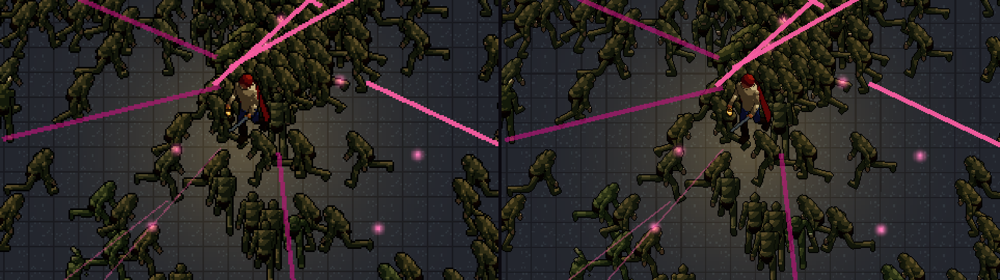
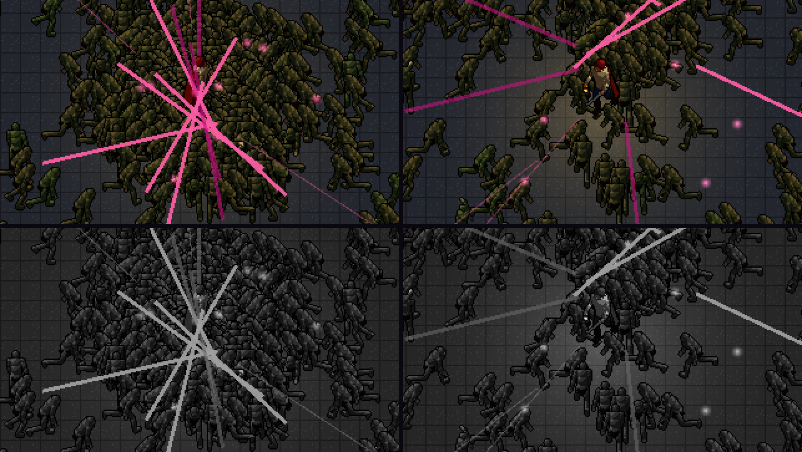

# G2.6 — Сетка 640×360 против 960×540 и читаемость без цвета (2026-10-26, macOS)

**Итог:** рекомендация — оставить **640×360** ([ADR 0003](../adr/0003-art-direction.md) п. 2). 960×540 даёт в 2,25 раза больше текселей и заметно тоньше детали, но читаемость орды в цифрах та же, а целого масштаба на 720p, Steam Deck и 1440p у неё нет. Без цвета рядовые читаются тёмным контуром на полу. Героя от орды отделяет светлый ключ — но только когда он виден спереди; со спины его прячет плащ. Это правило для концепт-художника, записано в [стиль-библию](../art/style-bible.md). Сравнение на Steam Deck и телефоне отложено вместе с замерами G1.3 и G1.4 (решение владельца: пока только ПК).

## Сцена
Спайк орды на Release-экспорте и в окне 1920×1080. Сим тот же, сид `spike`, `--fixed-fps 60` — обе сетки снимают один и тот же тик. Мир — всегда 640×360 единиц сима; на 960×540 камера увеличивает его в 1,5 раза, а листы `*_960` (тот же рендер с масштабом 1,5, [G2.3](G2.3-sprite-pipeline.md)) ложатся тексель в пиксель.

- **stand** — отряд стоит, 600 врагов без снарядов бенча, кадр 600: в кадре 353 врага.
- **kite** — автопилот уходит от орды, 1500 врагов, кадр 400: в кадре 332 врага.



## Целый масштаб
| Экран | 640×360 | 960×540 |
|---|---|---|
| 1280×720 | ×2 | ×1,33 — нецелый |
| Steam Deck 1280×800 | ×2, поле 640×400 | ×1,33 — нецелый |
| 1920×1080 | ×3 | ×2 |
| 2560×1440 | ×4 | ×2,67 — нецелый |
| 3840×2160 | ×6 | ×4 |

Нецелый масштаб пиксель-арта — либо мыло фильтрации, либо неровные пиксели, либо широкие поля при целом ×1.

## Читаемость без цвета
Игра снимает кадр и тот же кадр маской силуэтов (`--screenshot`); `glimmer_sprites readability` переводит кадр в OKLab-светлоту. **Контраст границы** — медиана |ΔL| между пикселем силуэта и соседом снаружи; порог 0,10. **Светлый ключ** — доля силуэта светлее пола на 0,15 L. Герой отличим от орды, если его светлый ключ больше на 15 п. п.

| Сцена | Сетка | Врагов в кадре | Герой: граница / ключ | Рядовые: граница / ключ | Герой отличим |
|---|---|---|---|---|---|
| stand | 640 | 353 | 0,141 / 45% | 0,269 / 8% | да, +37 п. п. |
| stand | 960 | 353 | 0,197 / 47% | 0,269 / 9% | да, +38 п. п. |
| kite | 640 | 332 | 0,243 / 13% | 0,269 / 6% | **нет**, +7 п. п. |
| kite | 960 | 332 | 0,289 / 14% | 0,269 / 7% | **нет**, +8 п. п. |



Как к этому пришли (каждая правка — по замеру):
1. Аддитивный свет фонаря рисовался поверх фигур и высветлял тёмный контур героя: контраст границы был 0,08–0,14, теперь пятно света лежит на полу под фигурами.
2. С туникой цвета индиго герой в сером совпадал с гулями (разница медиан светлоты 0,03). Льняная туника (рампа `bone`) дала светлый ключ 45–47% спереди. Со спины его закрывает тёмный плащ.
3. Рядовой «громила» (радиус 12) рисовался листом элиты 60 px и забивал кадр. Лист элиты теперь только у элит и босса.
4. Телеграфы цвета-резерва (маджента) читаются поверх всей орды и в цвете, и в сером (L 0,70 на полу 0,27).

## Что говорит сравнение сеток
- **Деталь:** на 960 капюшон, клинок и фонарь заметно тоньше, у героя выше контраст границы (0,197 против 0,141). Но и на 640 силуэты различимы, а с концепт-артом и ручной полировкой ключевых кадров разница сократится.
- **Вес:** листы 960 тяжелее в 1,65 раза на диске и в 2,25 раза в текселях. Для ручной анимации (контроль G2.5) это в 2,25 раза больше пикселей на кадр. Для 3D-конвейера цена одна — рендер.
- **Эффекты** рисуются в полном разрешении поверх пиксельного мира на любой сетке (ADR 0003 п. 2), поэтому сетка ограничивает только персонажей и окружение.
- **Решает целый масштаб:** первая платформа — ПК и Steam Deck, а 960 не масштабируется целым на Deck и 720p.

## Кадр
Release-экспорт macOS, 5 тыс. врагов и 2 тыс. снарядов, окно 1280×720, по 60 с подряд: сетка 640 — кадр 4,74 мс, p99 6,9, кадров дольше 8 мс 0,62%; сетка 960 — 4,72 мс, p99 6,7, 0,62%. По цене кадра сетки равны: спрайтов столько же, вызовов отрисовки 12, крупнее только текстуры. Хвост задаёт фон машины, а не листы (A/B с этапом 1 — в [G2.3](G2.3-sprite-pipeline.md)).

## Осталось
- Тот же кадр на Steam Deck (1280×800) и телефоне — с возвратом к G1.3 и G1.4.
- Светлый ключ героя со всех направлений — задача концепт-художнику (G2.2); проверка — тот же `readability` на настоящей модели.
- Ротация тонов по актам и элиты в кадре (в этих сценах их нет) — со срезом G2.4.

Повторить (путь снимка — абсолютный: из редактора Godot работает в каталоге `game/`):
```bash
make export-mac
build/macos/Glimmerfall.app/Contents/MacOS/Glimmerfall --resolution 1920x1080 --fixed-fps 60 -- --grid 960 --manual --projectiles 0 --enemies 600 --screenshot "$PWD/build/g26/stand-960" --screenshot-frame 600
PYTHONPATH=tools/sprites .venv/bin/python -m glimmer_sprites readability build/g26/stand-960
```
